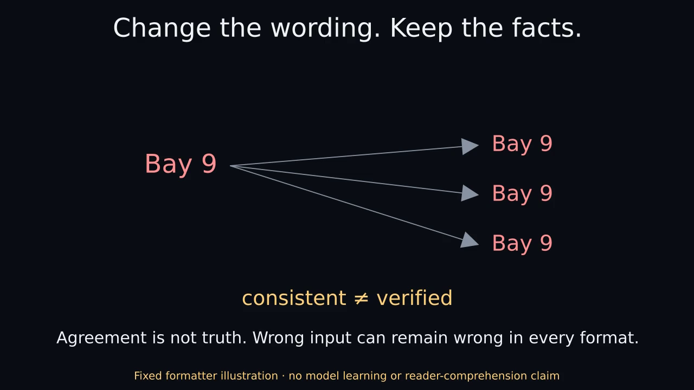

# Language for the Reader

An explanation should fit the reader without changing the facts. This project asks how to keep those two jobs separate: choosing what an answer says, and choosing how to present it.

The current experiments use explicit presentation requests, small structured tasks and a pinned language-model checkpoint. They measure answer correctness, changes across requested styles and template compliance. Whether an explanation actually helps people understand is a separate, still-open research question.

## Start here

- [Work through a two-minute content-and-presentation example](docs/START_HERE.md).
- [Read the research overview](docs/RESEARCH_OVERVIEW.md) for motivation, hypotheses, controls and the path toward reader studies.
- [Inspect the pretrained pilot's raw generations and findings](pretrained/results/RESULTS.md), or start with the faster synthetic experiment below.

## Watch the concept in 24 seconds

[](docs/animations/concept.mp4)

[24-second Manim MP4](docs/animations/concept.mp4) · [Optional GIF preview](docs/animations/concept.gif) · [Text transcript](docs/animations/transcript.txt) · [Captions](docs/animations/captions.vtt)

Rendered with Manim Community 0.22.0. Fixed template illustration · no model or reader experiment. No audio. The poster and transcript provide a no-motion alternative. The downloaded [HTML viewer](docs/animations/index.html) is static by default and never autoplays.

Here, “register” means the user's requested `introductory`, `working` or `technical` presentation. The system does not infer a reader's intelligence or demographics.

## What the studies found

- [Synthetic baseline](results/rebuild/summary.json): adding a register head or consistency loss did not fix factual degradation caused by conditioning content on presentation.
- [Content/formatting separation](milestone2/RESULTS.md): excluding register from content prediction guaranteed answer invariance. The separated predictors were more accurate than the conditioned model but did not beat the simpler unconditioned control. A fixed formatter preserves the predicted answer, including wrong predictions.
- [Pretrained LoRA pilot](pretrained/results/RESULTS.md): ordinary SFT, SFT plus an auxiliary head, and SFT plus head and consistency each scored 25/48 strict-correct responses. These cover 16 held-out source records in three registers. The untouched base's 0/48 came with zero parser coverage, so that comparison mixes format compliance with factual correctness.
- [Exploratory fourth label](pretrained/exploratory-results/RESULTS.md): already-inspected facts remained difficult across labels. This is an exploratory probe.
- [SFT learning curves](studies/sft-learning-curves/README.md): later ordinary SFT reached 46/48 on reused development validation. The separate repeat produced scheduled outputs through update 384, but its supervisor ended `incomplete/accounting_failure`. Both the numerical result and failed supervision status are preserved.

No auxiliary-head benefit or reader-comprehension improvement has been demonstrated.

## Run the NumPy rebuild

Python 3.11+ and NumPy are required. The recorded environment was Python 3.12.14 with NumPy 2.3.5. From the repository root:

```sh
export PYTHONPATH=src OPENBLAS_NUM_THREADS=1
python -m unittest discover -s tests -v
python -m run --out results/reproduction
python tooling/run_tests.py
```

These commands need no model, API or download. The run regenerates all 12 synthetic models, splits and histories; the text-only baseline omits binary weights. Use fresh output paths. The aggregate runner separates NumPy/tooling tests from the optional pretrained suite.

`sha256sum -c MANIFEST.sha256` checks the historical baseline snapshot, including an older README hash. Its README mismatch is expected after later documentation edits; that manifest is preserved as history, not a current-tree integrity certificate.

For the optional suite, follow the isolated setup and pinned-model fetch in [pretrained/README.md](pretrained/README.md), then run:

```sh
python tooling/run_tests.py --pretrained --model-dir "$MODEL_DIR"
```

[Learning-curve verification](studies/sft-learning-curves/REPRODUCE.md) distinguishes inspecting saved evidence, replaying checkpoints and training again.

## What comes next

A useful follow-up would compare ordinary SFT with auxiliary and stop-gradient controls on genuinely new facts, then test whether people understand independently authored explanations more accurately. Correctness, consistency, style compliance and comprehension need separate outcomes. The [overview](docs/RESEARCH_OVERVIEW.md) gives falsifiable next steps.

The NumPy studies are newly written recovery implementations. [The recovered historical README](historical/README.original.md) is preserved separately; its old metrics and commands are unvalidated historical material. Original code and synthetic data are [MIT licensed](LICENSE); the pretrained model and its retained notices use Apache-2.0.
